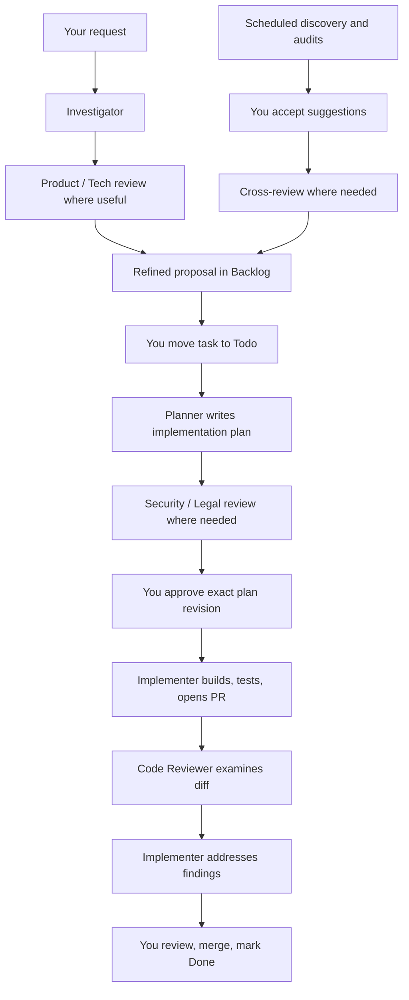

# Paperdev agent roles and workflow

Paperdev’s documented **Solo CTO setup had eight agent roles, with you as the final decision-maker**. The README still lists the original four; the fuller [company definition](doc/solo-cto/company/COMPANY.md) and [workflow guide](doc/SOLO-CTO-WORKFLOW.md) describe all eight.

## The roles

| Role | Responsibility | Main output |
|---|---|---|
| **Investigator** | Turns your rough request into a challenged, well-defined proposal. Checks existing behavior, value, alternatives, scope, risks, and acceptance criteria. Consults the leads where useful. | `investigation`, with **Go / Rethink / Drop** recommendation |
| **Tech Lead** | Finds technical improvements: bugs, reliability, tests, CI speed, developer experience, architecture, and debt. Reviews feasibility and technical approach. | Task proposals and `tech-review` |
| **Product Lead** | Finds user problems and product opportunities through repo analysis and web research. Reviews user value, flows, success metrics, and smaller alternatives. Writes a product spec when assigned directly. | Task proposals, `product-review`, optional `spec` |
| **Security Officer** | Audits dependencies, secrets, authentication, authorization, input handling, infrastructure, and data exposure. Reviews sensitive plans. | Task proposals and `security-review` |
| **Legal Officer** | Checks privacy and compliance gaps: consent, cookies, retention, deletion, processors, terms, and applicable company obligations. Flags decisions for you or counsel. | Task proposals and `legal-review` |
| **Planner** | Converts the agreed requirements into a concrete implementation plan grounded in the repository. Requests specialist reviews and your approval. | Versioned `plan` |
| **Implementer** | Builds the approved plan in a task worktree, runs checks, opens a PR, and addresses review findings. | Code, PR, `implementation-report` |
| **Code Reviewer** | Independently reviews the diff against the approved plan, identifies concrete bugs, and highlights decisions requiring human attention. Also audits systemic safeguards. | `code-review`: **Clear / Must read** |
| **You** | Set direction, accept proposals, prioritize work, answer questions, approve plans, review flagged changes, merge, and close tasks. | Decisions and approvals |

All eight were configured as local Claude Code agents. **Only the Implementer could modify repository code.** The others could still write task documents, comments, and review results in Paperclip.

## The end-to-end workflow

## 1. Intake: understand and challenge the request

You create a task, often just one sentence. With the Investigator configured as the project’s intake agent, it starts in **Backlog**, assigned to the Investigator.

The Investigator:

- Reads relevant code, product context, and related tasks.
- Challenges the request from business, product, technical, security, and legal angles.
- Defines scope, alternatives, acceptance criteria, size, and risks.
- Requests Product Lead or Tech Lead input where relevant.
- Bundles open questions into one question card for you.
- Refines the title and description while preserving your original request.
- Tags the task and parks it in **Backlog, assigned to the Planner**.

Even a **Drop** recommendation stays available for your decision; the Investigator recommends cancellation rather than deciding for you.

## 2. Prioritization: you choose what starts

Moving a task from **Backlog to Todo** starts planning.

This separates accepting that an idea is worth keeping from deciding to spend time on it now.

For larger product questions, there is an optional route: assign the task directly to the **Product Lead**, which writes a `spec`, gets your approval, then hands it to the Planner. **Spec approval and implementation-plan approval are separate decisions.**

## 3. Planning: define how to build it

The Planner reads the investigation, approved spec if present, reviews, code, and repository conventions.

Its plan includes:

- Problem and verified facts.
- Assumptions and relevant files.
- Ordered implementation steps.
- Tests and validation.
- Acceptance criteria.
- Risks, dependencies, open questions, and complexity.

Sensitive changes trigger **Security and/or Legal review before your approval**—particularly personal data, authentication, authorization, payments, secrets, or exposed infrastructure.

The Planner incorporates the findings, requests approval of the latest plan revision, and moves the task to **In review**.

## 4. Approval: authorize one specific revision

You can:

- **Approve:** implementation begins.
- **Reject with feedback:** the Planner revises and asks again.
- **Comment:** discuss or clarify.
- **Cancel:** stop the task.

Approval applies to the **exact current plan revision**. A later plan edit invalidates it. Assignment, comments, or moving a card to Todo do not constitute implementation approval.

## 5. Implementation: build and produce evidence

The Implementer:

1. Reads the approved plan revision.
2. Works in the task’s worktree and branch.
3. Implements the changes and runs relevant checks.
4. Pushes the branch and opens a PR.
5. Records the PR as a work product.
6. Writes an `implementation-report` covering changes, deviations, checks, and unresolved issues.
7. Requests a Code Reviewer child task and pauses while it completes.

If implementation requires a significant plan change, it requests approval of a new revision before proceeding.

The Implementer never merges or pushes to the default branch.

## 6. Independent review: fix bugs and focus your attention

The Code Reviewer checks:

- Whether the diff follows the approved plan.
- Concrete logic bugs and edge cases.
- Missing or weakened tests.
- Weakened CI, lint, type, or other safeguards.

It produces two kinds of findings:

| Finding | Action |
|---|---|
| **Fix** | Implementer addresses concrete bugs or explains disagreement. |
| **Must read** | You inspect up to three specific locations, with `file:line`, reasons, and what to check. |

**Clear** is the expected verdict for ordinary changes. It means the reviewer found nothing requiring special human attention; it does **not** mean tests passed. The reviewer cannot run tests or access GitHub in this setup.

The Implementer gets **one correction pass, without an automatic second review**, updates the report and PR’s “Agent review” section, then moves the task to **In review**.

## 7. Human acceptance and completion

You check CI and the implementation evidence.

- With **Clear**, the intended workflow is to merge once CI is green.
- With **Must read**, inspect the highlighted locations first.
- Merge the PR and mark the task **Done** yourself.

A successful agent run does not automatically complete the task.

## The proactive discovery loop

The documented schedule uses **Europe/Paris time**:

| Schedule | Owner | Focus |
|---|---|---|
| Daily, 08:00 | Tech Lead | Technical improvements |
| Daily, 09:00 | Product Lead | User friction, features, growth, retention |
| Monday, 10:00 | Legal Officer | Privacy and compliance |
| Tuesday, 10:00 | Security Officer | Application and infrastructure security |
| Wednesday, 08:00 | Tech Lead | Dead code, duplication, complexity, inefficiency |
| Thursday, 10:00 | Code Reviewer | Tests, CI gates, lint/type rules, agent instructions |

Each routine proposes **at most three evidenced tasks**, deduplicated against existing work and previous suggestions. Zero proposals is valid.

Only suggestions you accept become tasks. Product suggestions receive a Tech Lead feasibility review; other suggestions that change user-facing behavior receive a Product Lead impact review. They then wait in **Backlog with the Planner** until you move them to Todo.

## How handoffs and blockers work

Reviews are separate child tasks that block the parent. The requester retains ownership of the parent, ends its run, and resumes when the reviews finish. Specialist reviews use **OK / Concerns / Blocker** verdicts.

Agents also stop and ask you when they need missing access, credentials, clarification, or an external action. They record the blocker and resume after your response instead of polling.

The central division of responsibility was: **Investigator clarifies the request; Product Lead defines value; Tech Lead checks technical soundness; Planner defines execution; officers review risk; Implementer builds; Code Reviewer checks the diff; you authorize and accept the work.**
